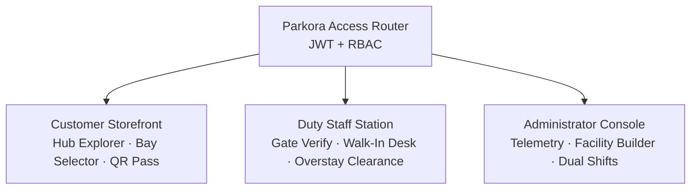

<div align="center">

# 🅿️ Parkora

### Smart Urban Parking & Transit Hub Gate Operations System

A full-stack parking management platform that connects **drivers**, **gate staff**, and **city administrators** through isolated, role-scoped portals, built for high-traffic transit hubs in Kannur, Kerala.

[](https://parkora-kannur.vercel.app)


</div>

---

## Overview

Parkora eliminates parking congestion at high-density transit nodes and commercial hubs, including **Kannur Central Bus Terminal**, **Kannur Railway Station Complex**, **Payyambalam Beach**, and multi-level parking lots.

Most parking apps stop at the driver's booking screen. Parkora is an end-to-end, multi-tenant operations system with strictly partitioned portals for:

| Portal | Audience | Purpose |
| --- | --- | --- |
| **Storefront** | Drivers / Customers | Discover hubs, reserve bays, receive a QR pass |
| **Gate Station** | Duty Staff | Verify passes, run walk-in bookings, clear exits and overstays |
| **Management Core** | Administrators | Monitor live telemetry, build facilities, manage shift rosters |

> **Try it now:** [parkora-kannur.vercel.app](https://parkora-kannur.vercel.app). Demo credentials are listed [below](#demo-credentials).

## Table of Contents

- [Multi-Portal Architecture](#multi-portal-architecture)
- [Features by Role](#features-by-role)
- [Operational Rules & Timing Thresholds](#operational-rules--timing-thresholds)
- [Demo Credentials](#demo-credentials)
- [Tech Stack](#tech-stack)
- [Project Structure](#project-structure)
- [Getting Started](#getting-started)
- [Environment Variables](#environment-variables)
- [API Reference](#api-reference)
- [Deployment](#deployment)
- [Author](#author)

<!--
## Screenshots
Add screenshots or a demo GIF here, for example:


-->

## Multi-Portal Architecture

Parkora enforces strict **Role-Based Access Control (RBAC)** on both the client routing layer (`ProtectedRoute.jsx`) and the backend Express middleware (`protect`, `authorize`).



- **Strict path isolation:** Staff cannot browse consumer catalogs (`/locations`). Customers cannot reach gate controls (`/staff/*`) or configuration (`/admin/*`).
- **Silent route bouncing:** A role mismatch redirects the user straight to their authorized dashboard, with no browser alerts.

## Features by Role

### 🚗 Driver / Customer Storefront

- **Facility discovery:** Browse public hubs with live tariff details (hourly base rate), operating hours, and amenities (CCTV, EV charging, 24/7 access).
- **Collision-proof bay booking:** Server-side interval evaluation prevents double-booking across overlapping arrival and departure windows.
- **Hashed QR passes:** Every booking generates a digital pass with a SHA-256 token hash that gate scanners can verify.

### 🛂 Staff Gate & Duty Station (`/staff`)

- **Duty-window lockout:** Shifts are validated against Indian Standard Time (IST, UTC+5:30). Off-duty operators cannot verify tickets, complete check-ins, or issue walk-in passes.
- **Walk-in counter terminal:**
  - On-the-spot bay reservations locked to the operator's assigned facility
  - Settlement by physical **cash collection** or a **test UPI QR** simulation
- **Gate pass verification:**
  - Verify by QR token or booking reference (`KSP-XXXXXX-XXX`)
  - Enforces the 5-minute early-entry window and 15-minute no-show cancellation
- **Check-out & overstay billing:**
  - 7-minute departure grace period with no overtime fee
  - Automatic surcharge for departures beyond the grace period
- **Demo utilities:**
  - `/staff/auto-switch-duty` switches to the rostered operator for rapid shift-handover demos
  - A toggleable **Auto-Discharge on Expiry** simulation clears parked bays when their scheduled duration ends

### 📊 Admin Operations Console (`/admin`)

- **Real-time telemetry:** Live bay occupancy ratios in interactive Recharts donut charts, plus revenue breakdown per facility.
- **Facility structure builder:** Add floors and configure bay capacity, vehicle type restrictions (`car`, `bike`, `ev`, `heavy`), and bay-specific pricing overrides.
- **Dual-shift roster management:** Assign staff across two equal shift blocks (Shift 1 / Shift 2), with overlap alerts for cross-assigned personnel.
- **Audit & handover ledger:** A real-time event log of duty logins, QR scans, check-outs, and walk-in passes.

## Operational Rules & Timing Thresholds

| Scenario | Condition | Enforced Action |
| --- | --- | --- |
| **Early arrival** | `arrival < start − 5 min` | Gate verification blocked; earliest allowed check-in time is shown |
| **Valid entry** | `start − 5 min ≤ arrival ≤ start + 15 min` | Pass approved; check-in recorded; bay marked active |
| **No-show expiry** | `now > start + 15 min` | Auto-cancelled by the background lifecycle worker; bay released |
| **Exit grace** | `exit ≤ end + 7 min` | Departure finalized with no penalty |
| **Overtime penalty** | `exit > end + 7 min` | Surcharge billed (formula below) |

$$
\text{Overstay Fee (₹)} = \left\lceil \frac{\text{Overstay Minutes}}{60} \right\rceil \times \text{Hourly Rate}
$$

A `node-cron` background worker sweeps every 60 seconds to cancel no-shows and advance booking lifecycle states.

## Demo Credentials

Pre-seeded accounts for exploring each role-isolated portal:

| Role | Email | Password | Access |
| --- | --- | --- | --- |
| System Admin | `admin@parkora.in` | `Admin@123` | Global metrics, facility builder, shift rosters |
| Duty Staff (Shift 1) | `staff1@parkora.in` | `Staff@123` | Kannur Central Bus Terminal, 06:00 – 18:00 IST |
| Duty Staff (Shift 2) | `staff2@parkora.in` | `Staff@123` | Kannur Central Bus Terminal, 18:00 – 06:00 IST |
| Customer | `customer@parkora.in` | `Customer@123` | Hub search, bay reservations, digital pass |

> [!TIP]
> If you open the staff terminal outside an assigned shift window, click **Auto-Switch to On-Duty Staff** to switch to the operator rostered for the current shift.

> [!NOTE]
> These are demo accounts for evaluation only. Never reuse these credentials, or the default `JWT_SECRET`, in a real deployment.

## Tech Stack

| Layer | Technologies |
| --- | --- |
| **Frontend** | React 18, React Router v6, Tailwind CSS, Framer Motion, Lucide React, Recharts, QRCode.react, Axios |
| **Backend** | Node.js, Express.js |
| **Database** | MongoDB with Mongoose (sessions and multi-document transactions) |
| **Auth & Security** | Stateless JWT, role-based middleware, bcryptjs password hashing, SHA-256 QR token hashing |
| **Automation** | `node-cron` background worker (60-second lifecycle sweep) |
| **Hosting** | Vercel (client), Render (API), MongoDB Atlas (database) |

## Project Structure

```text
parkora/
├── client/
│   └── src/
│       ├── api/                      # Axios instance with auth interceptors
│       ├── components/               # Navbar, ProtectedRoute, ScrollToTop
│       ├── context/                  # AuthContext (JWT state & user credentials)
│       ├── pages/
│       │   ├── Home.jsx              # Public landing page
│       │   ├── Login.jsx             # Role-routed authentication
│       │   ├── Locations.jsx         # Public parking hubs catalog
│       │   ├── BookingFlow.jsx       # Customer bay selector & checkout
│       │   ├── Ticket.jsx            # Digital pass with QR token
│       │   ├── StaffHome.jsx         # Staff overview & schedule banner
│       │   ├── StaffPortal.jsx       # Gate verification & check-out desk
│       │   ├── StaffBookCustomer.jsx # Walk-in desk (Cash / UPI QR)
│       │   ├── StaffTodayBookings.jsx# Daily facility arrivals ledger
│       │   └── AdminDashboard.jsx    # Telemetry, layout builder, rosters
│       └── App.jsx
└── server/
    ├── config/                       # MongoDB connection
    ├── controllers/                  # admin, staff, booking controllers
    ├── jobs/                         # bookingLifecycleJob.js (cron cleanup)
    ├── middleware/                   # auth.js (JWT extraction & role guards)
    ├── models/                       # Booking, ParkingLocation, Floor, ParkingBay, User
    ├── routes/                       # admin, staff, booking, auth routes
    ├── utils/                        # shiftHelper.js (IST duty calculation)
    └── server.js                     # Express bootstrap
```

## Getting Started

### Prerequisites

- [Node.js](https://nodejs.org/) 18 or later
- A MongoDB instance (local or [MongoDB Atlas](https://www.mongodb.com/atlas))

> [!IMPORTANT]
> Booking uses MongoDB multi-document transactions, which require a **replica set**. A standalone local `mongod` will not work. Use MongoDB Atlas (free tier) or run a local replica set.

### 1. Clone the repository

```bash
git clone https://github.com/sayanthkv/parkora.git
cd parkora
```

### 2. Set up the backend

```bash
cd server
npm install
```

Create `server/.env` (see [Environment Variables](#environment-variables)), then seed the database and start the server:

```bash
npm run seed   # seeds facilities, bays, and demo accounts
npm run dev
```

### 3. Set up the frontend

```bash
cd ../client
npm install
```

Create `client/.env`, then start the dev server:

```bash
npm run dev
```

Open **http://localhost:5173** in your browser.

## Environment Variables

**`server/.env`**

| Variable | Description | Example |
| --- | --- | --- |
| `PORT` | API server port | `5000` |
| `MONGO_URI` | MongoDB connection string (replica set required) | `mongodb+srv://<user>:<pass>@<cluster>/parkora` |
| `JWT_SECRET` | Secret used to sign JWTs | `your_jwt_private_key_here` |
| `CLIENT_URL` | Allowed frontend origin (CORS) | `http://localhost:5173` |

**`client/.env`**

| Variable | Description | Example |
| --- | --- | --- |
| `VITE_API_BASE_URL` | Base URL of the API | `http://localhost:5000/api` |

## API Reference

All Staff and Admin endpoints require a valid JWT and the matching role.

### Staff Operations: `/api/staff`

| Method | Route | Description |
| --- | --- | --- |
| `GET` | `/api/staff/shift-context` | Operator duty status, personal roster, and facility shift data |
| `POST` | `/api/staff/verify` | Validates gate QR passes against facility scoping and arrival buffers |
| `POST` | `/api/staff/check-in/:bookingId` | Approves vehicle entry and marks the session active |
| `POST` | `/api/staff/check-out/:bookingId` | Finalizes departure and assesses overtime past the 7-minute grace |
| `POST` | `/api/staff/book-customer` | Issues a walk-in pass with cash or test UPI settlement |
| `POST` | `/api/staff/toggle-auto-complete` | Toggles the automated discharge simulation |

### Administrator Suite: `/api/admin`

| Method | Route | Description |
| --- | --- | --- |
| `GET` | `/api/admin/metrics` | System-wide capacity, live occupancy, and revenue |
| `GET` | `/api/admin/locations-shifts` | Facilities with their rostered operators |
| `POST` | `/api/admin/locations` | Adds a parking facility with coordinates and rates |
| `POST` | `/api/admin/locations/:id/floors` | Creates a floor within a facility |
| `POST` | `/api/admin/locations/:id/floors/:floorId/bays` | Adds bay slots with vehicle type classification |
| `PATCH` | `/api/admin/staff/:id/assign-shift` | Reassigns staff across the two shift blocks |
| `GET` | `/api/admin/staff-activity` | Audit log of all check-ins, exits, and handovers |

## Deployment

| Service | Hosts | Notes |
| --- | --- | --- |
| **Vercel** | React client | Set `VITE_API_BASE_URL` to your API URL |
| **Render** | Express API | Set `MONGO_URI`, `JWT_SECRET`, and `CLIENT_URL` (your Vercel URL) |
| **MongoDB Atlas** | Database | Replica set by default, so transactions work out of the box |

> [!NOTE]
> On Render's free tier the API sleeps when idle, so the first request after a quiet period can take 30–60 seconds.

## Author

**Sayanth KV** (Sayanth Sajeevan), MERN Stack Developer

[](https://www.linkedin.com/in/sayanth-thedeveloper)
[](https://github.com/sayanthkv)
[](mailto:sayanthsajeev363@gmail.com)

---

<div align="center">

If you find Parkora useful, consider giving it a ⭐. Feedback and suggestions are welcome!

</div>